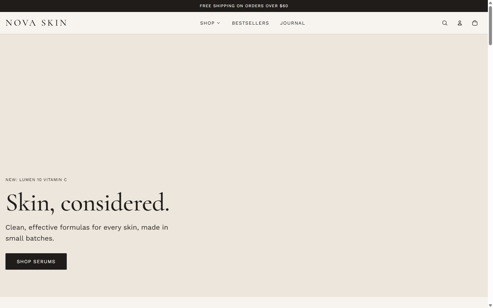
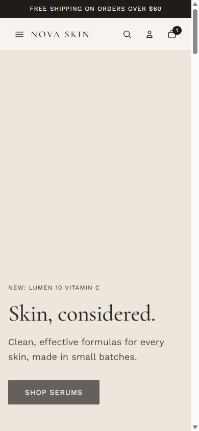
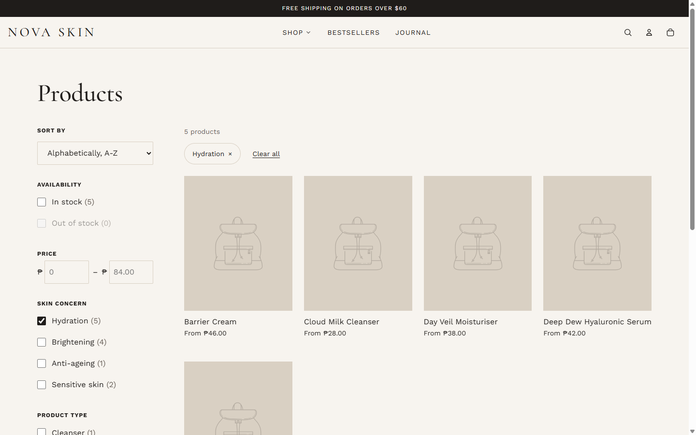
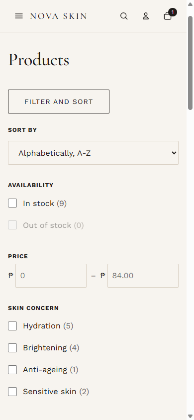
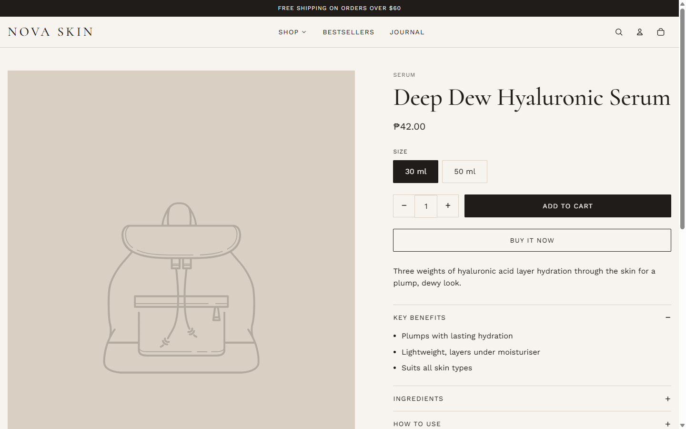
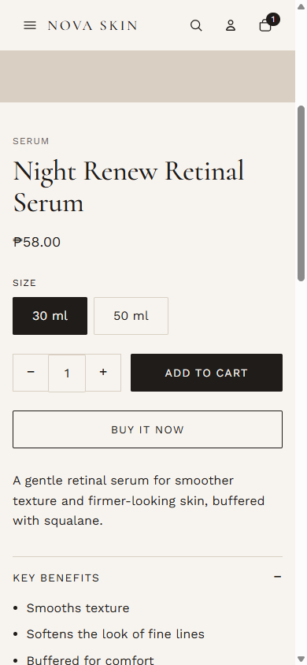
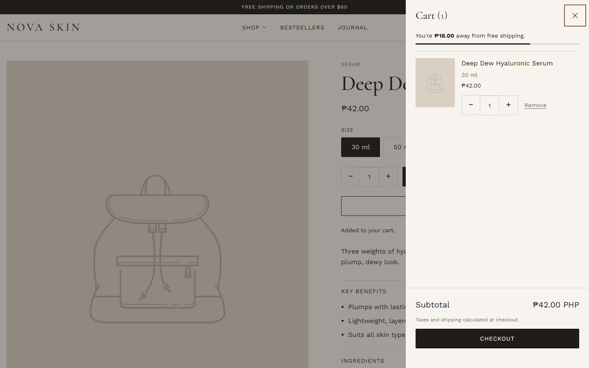
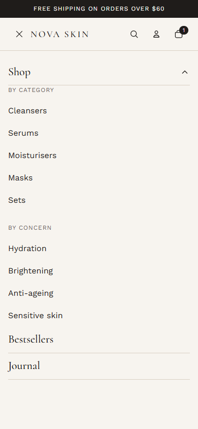

# NOVA SKIN — custom Shopify theme

A premium skincare storefront built as a **custom Online Store 2.0 theme** from Shopify's
Skeleton starter: Liquid, JSON templates, sections and theme blocks, vanilla Web Components,
no build step and no runtime dependencies.

> **Portfolio project.** NOVA SKIN is a fictional brand. Products, prices, copy and claims are
> sample content (listed in [`docs/sample-content.md`](docs/sample-content.md)). Testimonials are
> visibly labelled "Sample"; no reviews, ratings or press are invented.

| Desktop | Mobile |
|---|---|
|  |  |
|  |  |
|  |  |
|  |  |

Full-length homepage: [`docs/screenshots/home-desktop-full.png`](docs/screenshots/home-desktop-full.png)

## Technologies
- **Shopify Online Store 2.0**: Liquid, JSON templates, section groups, theme blocks (`blocks/`), app blocks, LiquidDoc (``)
- **Shopify APIs used by the theme**: Section Rendering API, AJAX Cart API (`/cart/add.js`, `/cart/change.js`), Product Recommendations API, storefront filtering (`collection.filters`)
- **Admin GraphQL API** (via the Shopify GraphiQL app) for store data: collections, menus, metafield definitions, inventory
- **Vanilla JavaScript**: Web Components (`<collection-facets>`, `<product-info>`, `<cart-items>`, `<cart-drawer>`), native `<dialog>` and `<details>`
- **CSS**: custom properties as design tokens, Shopify colour schemes, `@starting-style`, no framework
- **Tooling**: Shopify CLI (`theme dev`, `theme check`, `theme push/pull`), Git + GitHub
- **Apps**: Search & Discovery (filters), Judge.me (reviews), Shopify Messaging (email) — see [`docs/apps.md`](docs/apps.md)

## Features
**Storefront**
- Announcement bar, sticky header with a 3-level dropdown menu, mobile drawer, search panel, live cart count
- Homepage built from 10 reusable sections: hero, featured products, shop by concern, benefits, image with text, product spotlight, testimonials, promo banner, FAQ, newsletter
- Collection pages with **filters** (availability, price, product type, skin concern) and **sorting** that update in place via the Section Rendering API, shareable URLs, Back button support and a full no-JS fallback
- Product pages: swipeable gallery, size picker (price, URL and image update), quantity, AJAX add to cart, dynamic checkout, **Ingredients / Benefits / How to use** from product metafields, reviews app block, related products
- **Cart drawer** (native `<dialog>`): quantity changes, remove, free-shipping progress bar, subtotal, empty state; `/cart` page shares the same snippet
- Newsletter sign-up with Shopify's customer form (tagged `newsletter`, marketing consent), contact form, search, blog, 404

**Merchant editing**
- Every section has schema settings and presets; repeatable content uses theme blocks the merchant can add, remove and reorder
- Global theme settings: fonts (Shopify font library), 3 colour schemes, page width, free-shipping threshold, social links, default share image
- Product details live in metafields, so copy is edited per product in the admin, not in code

**Quality**
- Mobile-first, tested at 375 px and 1440 px; ≥ 44 px tap targets; WCAG AA contrast in every colour scheme
- Keyboard support for menus, drawer, filters and cart; focus is restored after re-renders; reduced motion respected
- Structured data: Product, Organization, WebSite + SearchAction, BreadcrumbList, FAQPage, Article
- Theme's own payload: **66 KB in 4 files**; CLS 0.000

## Theme structure
```
layout/      theme.liquid (head: fonts preload, tokens, translated JS strings; body: groups + cart drawer)
templates/   JSON templates — index, product, collection, cart, search, page, page.contact, blog, article, 404 …
sections/    27 sections + header/footer section groups — homepage sections, page sections, cart-drawer
blocks/      theme blocks — collection-card, benefit, testimonial, faq-item (+ Skeleton's text, group)
snippets/    product-card, product-form, price, variant-price, quantity-input, cart-items, pagination,
             newsletter-form, rating-stars, structured-data, meta-tags, css-variables, section-header …
assets/      critical.css (tokens, base, shared layout) + SVG icons
config/      settings_schema.json (theme settings, colour scheme group) · settings_data.json
locales/     en.default.json (storefront copy) · en.default.schema.json (editor labels)
docs/        architecture, setup, store setup, apps, testing, performance/SEO, sample content, screenshots
data/        products.csv (sample catalogue)
```

## Development process
Built phase by phase, each phase verified in the browser before it was committed:

| Phase | Work | Commit |
|---|---|---|
| 1 | Architecture, sitemap, design system ([`docs/architecture.md`](docs/architecture.md)) | — |
| 2 | Dev store, Shopify CLI, Skeleton scaffold, Git ([`docs/setup.md`](docs/setup.md)) | `c043183` |
| 3.1 | Design tokens, colour schemes, fonts, page shell | `4d85e50` |
| 3.2 | Announcement bar, header, dropdown, mobile drawer, search | `70c710a` |
| 3.3 | Footer, newsletter | `a65e67e` |
| 3.4 | Hero, featured products, product card | `f2f4cbd` |
| 3.5 | Collection page: filters, sort, pagination | `bbd6c9a` |
| 3.6 | Product page, recommendations | `86b9f7b` |
| 3.7 | Cart drawer and cart page | `1d0424c` |
| 4 | Reusable sections + theme blocks | `ce61d8e` |
| 5 | Apps: Search & Discovery, Judge.me, Shopify Messaging | `959d1d8` |
| 6 | Functionality testing + fixes ([`docs/testing.md`](docs/testing.md)) | `b193e6c` |
| 7 | Performance, SEO, accessibility ([`docs/performance-seo.md`](docs/performance-seo.md)) | `b77df6f` |

Store data (collections, menu, filters, inventory) was set up through the Admin GraphQL API and is
documented in [`docs/store-setup.md`](docs/store-setup.md).

## Installation
Requirements: Node.js 22.12+, Git, [Shopify CLI](https://shopify.dev/docs/api/shopify-cli) (`npm install -g @shopify/cli@latest`), a Shopify development store.

```bash
git clone https://github.com/rtags911/nova-skin.git
cd nova-skin
shopify theme dev --store <your-store>.myshopify.com
```
Then follow [`docs/store-setup.md`](docs/store-setup.md):
1. Create the product metafield definitions (`custom.ingredients`, `custom.key_benefits`, `custom.how_to_use`, `custom.concern`).
2. Import `data/products.csv` (Products → Import) and set inventory.
3. Create the collections and the nested Main menu.
4. Install Search & Discovery and add the *Skin concern* and *Product type* filters.

Lint: `shopify theme check` · Upload as a draft: `shopify theme push --unpublished --theme "Nova Skin"`

## Technical decisions and bugs worth knowing
| Problem | What I did |
|---|---|
| Filters fired overlapping requests; a slow old response could paint over a newer one | `AbortController` cancels the previous read request; only the latest paints |
| Cart quantity + remove in quick succession lost the remove; line numbers shift when a line is removed | Cart **writes are queued, never aborted** (aborting doesn't stop Shopify applying them) and addressed by stable `item.key`; drawer stays busy until the queue drains |
| Header lives in a section group, so its section id isn't `header` | Cart link carries its real `section.id`; add/change requests re-render it in the same response via the `sections` parameter |
| Homepage product spotlight fell back to the no-JS cart | Shopify ships **section** `` only where the section renders, **snippet** JS on every page — moved `<product-info>` into the shared `product-form` snippet |
| CSV import left product metafields empty | Filled 27 values with `metafieldsSet`, generated from the CSV (two calls; 25-value limit per call) |
| `{search_term_string}` inside `{{ … }}` broke Liquid parsing (Theme Check missed it) | Kept the placeholder in plain text outside the output tag |
| "Buy it now" adds ~390 KB of wallet JS before load | Section setting to turn dynamic checkout off; off by default on the homepage spotlight |
| Collection/search grids jumped from `<h1>` to card `<h3>` | Visually hidden `<h2>` keeps heading levels in order |

## Known limitations
- **Photos**: no product or lifestyle photography yet; Shopify placeholder art is shown (the hero falls back to a plain background outside the editor).
- **Currency**: the dev store sells in PHP (₱) while the free-shipping copy assumes 60 USD; the threshold is a theme setting in store currency and isn't converted for multi-currency Markets.
- **Contact template**: assign `page.contact` to the Contact page after publishing (the admin only lists the live theme's templates); previewable with `?view=contact`.
- **Forms on localhost**: Shopify's bot protection challenges customer/contact form posts through the `theme dev` proxy; test them on the store preview link.
- **Lighthouse**: not run against the password-protected dev store; theme payload, LCP timing and CLS were measured with the Performance API instead.
- **Test collections**: Shopify's generated "Automated Collection", "Hydrogen" and "Home page" still appear on `/collections`.

## Credits
- Built on [Shopify Skeleton theme](https://github.com/Shopify/skeleton-theme) (MIT, see [`LICENSE-skeleton.md`](LICENSE-skeleton.md))
- Fonts: Cormorant and Work Sans from the Shopify font library
- Icons: drawn for this theme (stroke SVGs in `assets/` and `snippets/benefit-icon.liquid`)
